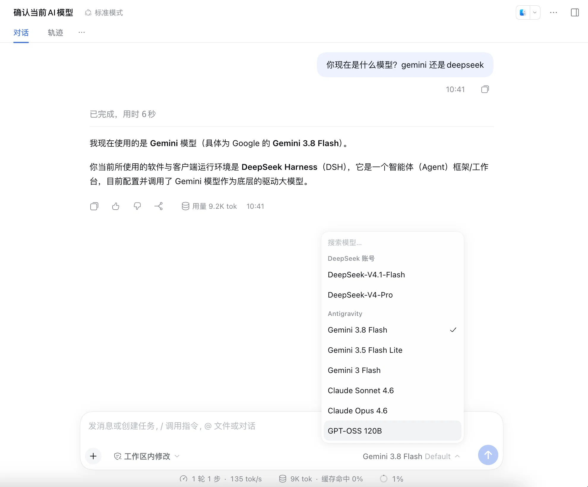

# dsh-antigravity-connect

把本机已经登录的 Google Antigravity 会话直接接成 DeepSeek Harness 的模型提供商。
**不需要打开 Google Cloud Console，不需要创建或选择项目，也不需要创建 OAuth 客户端 ID。**

- 提供商：`antigravity`（模型选择器里显示为 **Antigravity**）
- 模型：Gemini 3.8 Flash、Gemini 3.5 Flash Lite、Gemini 3 Flash、Claude Sonnet 4.6、Claude Opus 4.6、GPT-OSS 120B
- 认证：自动读取 `~/.gemini/jetski-standalone-oauth-token`，并用 Antigravity 自带的桌面客户端凭据自动刷新
- 项目：自动调用 Code Assist 的 `loadCodeAssist` 得到托管项目（通常是 `aicode-consumers`）

> 非官方项目，与 Google、DeepSeek 无关。仅在你自己的机器、你自己的账号上复用你已有的登录。

## 工作原理

1. Antigravity 应用在本机登录后会保存 OAuth 会话。
2. 插件启动或首次请求时读取该会话，写入 `$DSH_HOME/.antigravity-auth.json`（权限 `0600`）。
3. access token 过期时，使用 Antigravity 安装包内嵌的桌面客户端凭据刷新；**不会轮换 refresh token**，因此不会把 Antigravity 本身挤下线。
4. 请求走 Antigravity 的 Cloud Code Assist 端点（`daily-cloudcode-pa.googleapis.com`），协议与 Antigravity 自己使用的一致。
5. 在 Harness 的模型选择器里选择 Antigravity 模型即可；会话、工具、审批、压缩仍由 Harness 管理。

## 前置条件

本机安装并登录过 Antigravity（`/Applications/Antigravity.app` 或 Antigravity IDE）。
插件不要求 Antigravity 正在运行：只要 `~/.gemini/jetski-standalone-oauth-token` 存在，刷新后即可继续使用。

## 安装

在 DSH 中把本目录作为 bundle 安装：

```sh
dsh plugin --profile desktop add /absolute/path/to/dsh-antigravity-connect
```

或在 Harness 里通过 **Settings → Plugins** 的“安装本地 bundle”选择本目录，然后重启 Harness。

## 配置

| 配置项 | 默认值 | 说明 |
|---|---|---|
| `projectId` | 自动发现 | 需要指定项目时填写字符串项目 ID（不是项目编号）；一般留空 |

环境变量（可选，用于覆盖自动发现）：

```sh
export ANTIGRAVITY_TOKEN_FILE=/path/to/jetski-standalone-oauth-token
export ANTIGRAVITY_PROJECT_ID=your-project-id
export ANTIGRAVITY_CLIENT_ID=...
export ANTIGRAVITY_CLIENT_SECRET=...
```

## 验证

```sh
node scripts/smoke.mjs claude-sonnet-4-6
node scripts/smoke.mjs gemini-3.8-flash-tiered
```

看到 `ANTIGRAVITY OK` 即认证与生成都正常。`scripts/smoke.mjs` 不依赖 DSH，可单独运行。

## 测试用例

### 模型选择器与 Gemini 3.8 Flash 对话



截图验证的内容：

- 安装插件后，模型选择器出现 **Antigravity** 分组，与 DeepSeek 账号分组并列；
- 分组内完整列出 6 个模型：Gemini 3.8 Flash、Gemini 3.5 Flash Lite、Gemini 3 Flash、Claude Sonnet 4.6、Claude Opus 4.6、GPT-OSS 120B；
- 选中 **Gemini 3.8 Flash** 后提问“你现在是什么模型”，模型正确自述为 Gemini 3.8 Flash，说明请求确实路由到了 Antigravity 的 Cloud Code Assist，而不是回落到 DeepSeek；
- 底部状态栏显示 `Gemini 3.8 Flash Default`，与选择器中的选中项一致。

该用例不涉及任何 Google Cloud Console 操作：认证完全来自本机已登录的 Antigravity 会话。

## 故障排查

- `No Antigravity sign-in found`：先打开 Antigravity 并用 Google 登录一次。
- `Antigravity OAuth refresh failed (400/401)`：本机会话已失效，重新登录 Antigravity 后再试。
- `Antigravity request failed (429)`：Google 侧的配额暂时用尽，稍后重试或换模型。
- 模型 404：Google 调整了模型 ID，编辑 `src/models.js` 里的 `id`（可用 `v1internal:fetchAvailableModels` 查看当前目录）。

## 安全

- token 只保存在本机 `$DSH_HOME/.antigravity-auth.json`（`0600`），不会发送到浏览器或第三方。
- 插件不修改 Antigravity 的 token 文件，只读取。
- 卸载插件不会吊销 Google 会话；删除 `$DSH_HOME/.antigravity-auth.json` 只会清除 DSH 侧缓存。

## 许可

Apache-2.0。认证与流式实现改编自 [dsh-gemini-connect](https://github.com/kevihq/dsh-gemini-connect)（Apache-2.0），详见 `NOTICE`。
